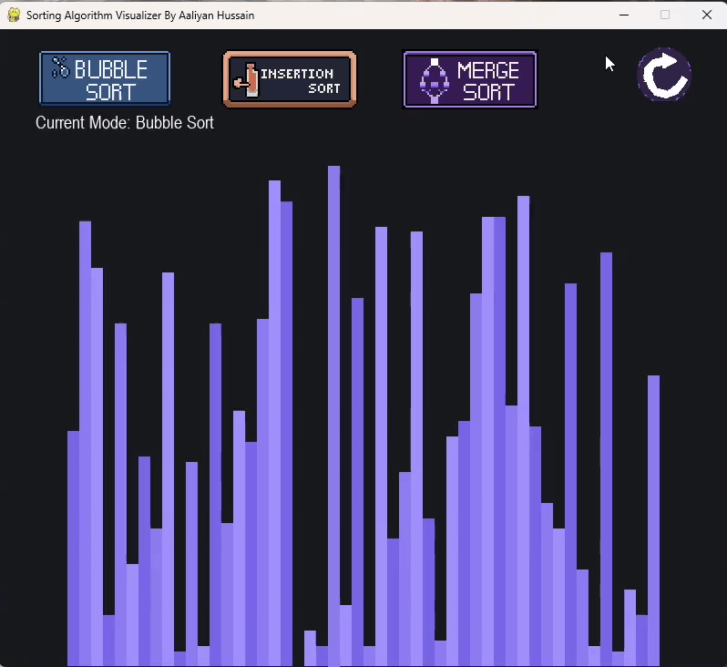
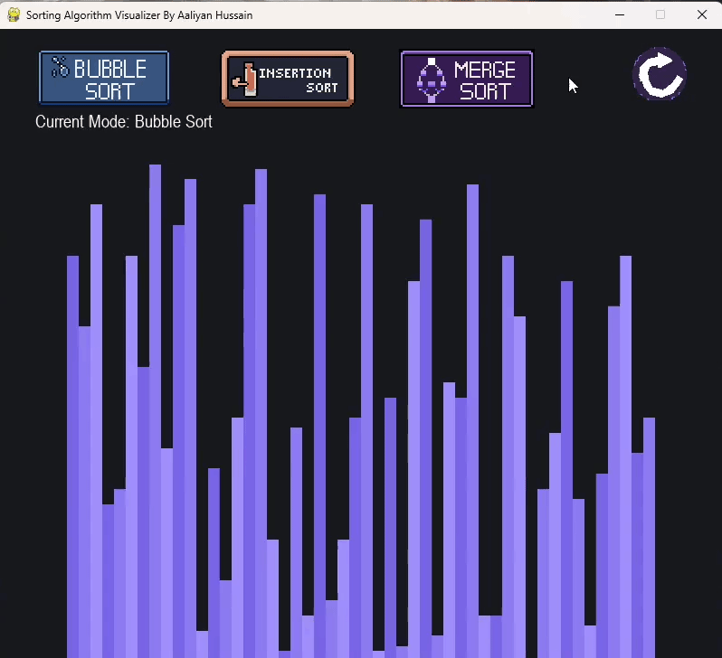
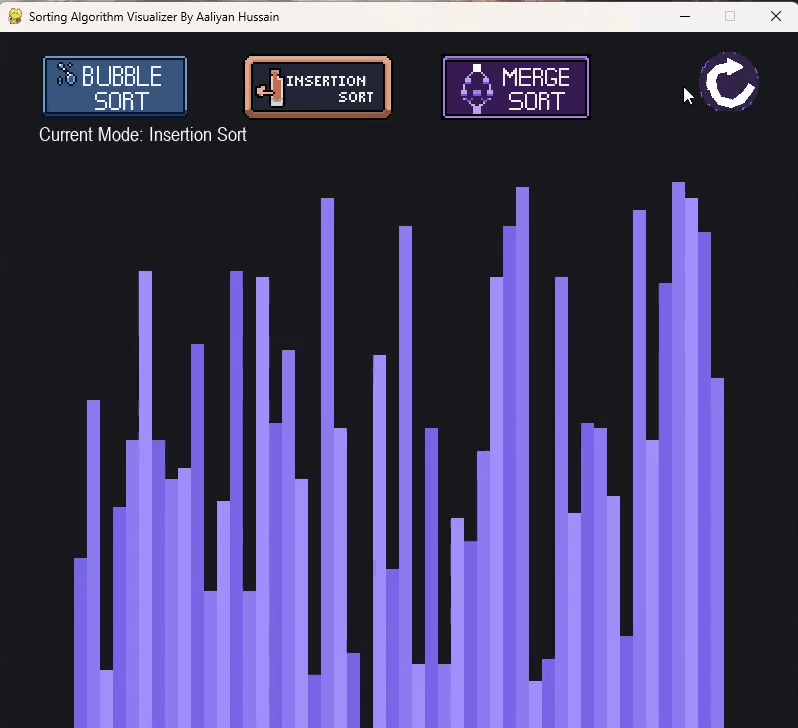

# Sorting Algorithm Visualizer

A custom-built interactive sorting algorithm visualizer developed in **Python** using **Pygame**. This project features a hand-crafted pixel art UI designed in LibreSprite and real-time step-by-step animations for classic sorting algorithms.

---

## Demos

### Bubble Sort


### Insertion Sort


### Merge Sort


---

## Features

* **Multiple Sorting Algorithms:** Switch between Bubble, Insertion, and Merge sort in real time.
* **Custom Pixel Art UI:** Retro buttons and UI elements made from scratch using LibreSprite.
* **Array Reset:** Shuffle the array anytime to test the algorithms on fresh data.
* **Clean Display:** Scaled to 800x700 resolution so the bars and controls fit without clutter.

---

## Tech Stack

* **Language:** Python
* **Library:** Pygame
* **Asset Design:** LibreSprite

---

## Complexity

| Algorithm | Best Time | Average Time | Worst Time | Space Complexity |
| :--- | :--- | :--- | :--- | :--- |
| **Bubble Sort** | O(n) | O(n²) | O(n²) | O(1) |
| **Insertion Sort** | O(n) | O(n²) | O(n²) | O(1) |
| **Merge Sort** | O(n log n) | O(n log n) | O(n log n) | O(n) |

---


### Prerequisites

Make sure you have Python installed on your system. You will also need the `pygame` library.

```bash
pip install pygame
